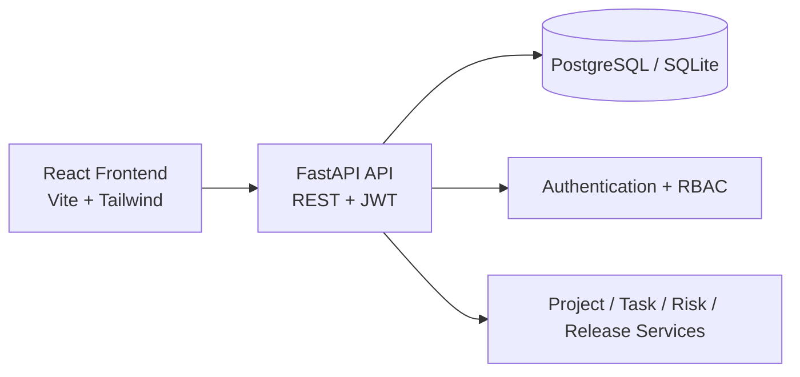

# TECHFLOW

TechFlow is an engineering program and release management platform built with FastAPI, SQLAlchemy, React, TypeScript, and Vite.

## High-level architecture



## Features

- Program dashboard with KPIs and charts
- Project, task, risk, blocker, milestone, release management
- JWT auth and RBAC
- Dependency validation and project health scoring
- Status reports and notification center
- Demo seed data for local experience

## Tech stack

- Frontend: React, TypeScript, Vite, React Router, Tailwind CSS, Recharts
- Backend: FastAPI, SQLAlchemy, Pydantic, Alembic
- Database: PostgreSQL (Docker) with SQLite fallback for local dev
- Auth: JWT + bcrypt
- Testing: pytest, React Testing Library

## Demo credentials

- Admin: admin@techflow.dev / Admin@123
- Program Manager: pm@techflow.dev / PM@123
- Engineer 1: engineer1@techflow.dev / Engineer@123
- Engineer 2: engineer2@techflow.dev / Engineer@123
- Viewer: viewer@techflow.dev / Viewer@123

## Local setup

1. Create and activate a virtual environment.
2. Install backend dependencies:
   `pip install -r backend/requirements.txt`
3. Copy `.env.example` to `.env` and adjust values.
4. Run migrations and seed data:
   `python backend/app/db/init_db.py`
5. Start backend:
   `uvicorn backend.app.main:app --reload --host 0.0.0.0 --port 8000`
6. In another terminal, install frontend dependencies:
   `cd frontend && npm install && npm run dev`
7. Visit http://localhost:5173

## Docker setup

```bash
docker compose up --build
```

Frontend runs on http://localhost:5173 and backend on http://localhost:8000.

## Environment variables

See `.env.example` for variables including `DATABASE_URL`, `JWT_SECRET`, and `VITE_API_URL`.

## Database migration

The project includes Alembic configuration under `database/migrations`.

```bash
cd backend
alembic upgrade head
```

## Seed data

The backend auto-seeds demo users, projects, tasks, risks, blockers, milestones, releases, and activities on first startup if the database is empty.

## Testing

```bash
pytest backend/tests
cd frontend && npm run build
```

## Screenshots

Placeholder for screenshots and demo recordings.

## Future improvements

- SSO integration
- WebSocket live updates
- Advanced portfolio analytics
- Approval workflow and change control

## License

MIT
